# Lab7Web_PHP – Praktikum Pemrograman Web (PHP)

**Nama:** Chelsea Meynita Vadlistya  
**NIM:** 312510447  
**Program Studi:** Teknik Informatika  
**Kelas:** _[isi kelas]_

---

## 1. Tujuan

1. Memahami perbedaan pemrosesan _client-side_ dan _server-side_.
2. Menjalankan file PHP melalui web server lokal.
3. Menggunakan variabel, operator, percabangan (`if/elseif/else`), array, dan perulangan (`foreach`) pada PHP.
4. Membuat dan memanggil _function_ untuk menghindari penulisan kode berulang.
5. Mengambil data form dengan metode `GET` dan `POST` (`$_GET`, `$_POST`).
6. Memvalidasi input di sisi server dan menampilkan data dengan aman memakai `htmlspecialchars()`.
7. Membuat mini project formulir data mahasiswa dengan validasi lengkap.

## 2. Perangkat

| Kebutuhan | Keterangan |
|---|---|
| Sistem operasi | Windows / Linux / macOS |
| PHP | Versi 8.x (memakai operator `??` dan `compact()`) |
| Web server | Built-in server PHP (`php -S`) atau XAMPP/Laragon (Apache) |
| Browser | Chrome / Edge / Firefox |
| Code editor | Visual Studio Code |

## 3. Cara Menjalankan Server Lokal

File PHP **tidak boleh** dibuka dengan klik ganda (`file://...`) karena kode PHP hanya dieksekusi oleh web server.

### Opsi A – Built-in server PHP (paling cepat)

```bash
cd Lab7Web_PHP
php -S localhost:8000
```

Lalu buka di browser:

```
http://localhost:8000/latihan1.php
```

Tekan `Ctrl + C` di terminal untuk menghentikan server.

### Opsi B – XAMPP / Laragon

1. Salin folder `Lab7Web_PHP` ke `C:\xampp\htdocs\` (XAMPP) atau `C:\laragon\www\` (Laragon).
2. Jalankan **Apache** dari control panel.
3. Buka `http://localhost/Lab7Web_PHP/latihan1.php`.

## 4. Struktur File

```
Lab7Web_PHP/
├── latihan1.php        # Hello PHP + waktu server (date)
├── latihan2.php        # Nilai akhir berbobot + predikat (if/elseif)
├── latihan3.php        # Array + foreach (daftar mahasiswa)
├── latihan4.php        # Function: hitungDiskon() dan hitungLuas()
├── latihan5.php        # Form GET: pencarian kata kunci
├── latihan6.php        # Form POST: nama & program studi
├── latihan7.php        # Form POST + validasi: pengolahan data barang
├── eksperimen1.php     # Rata-rata nilai
├── eksperimen2.php     # Pencarian nama di array (GET + in_array)
├── eksperimen3.php     # Function formatRupiah()
├── eksperimen4.php     # Validasi NIM 9 digit (POST + preg_match)
├── mini_project.php    # Formulir data mahasiswa + validasi lengkap
├── screenshots/        # Bukti screenshot browser (lihat bagian 6)
└── README.md
```

## 5. Ringkasan Hasil

| File | Konsep | Hasil yang ditampilkan |
|---|---|---|
| `latihan1.php` | `echo`, `date()` | Teks "PHP berhasil dijalankan." dan waktu server saat halaman dibuka. |
| `latihan2.php` | variabel, operator, `if/elseif` | Nilai akhir = 30% tugas + 30% UTS + 40% UAS = **84,90** → predikat **B**. |
| `latihan3.php` | array, `foreach` | Daftar bernomor 7 mahasiswa (Alya sampai Gina). |
| `latihan4.php` | function | Harga setelah diskon 10% dari Rp150.000 = **Rp135.000**; luas persegi panjang 8 × 4 = **32 cm²**. |
| `latihan5.php` | `GET`, `isset`, `htmlspecialchars` | Menampilkan "Kata kunci: …" sesuai input; parameter tampil di URL (`?kata=...`). |
| `latihan6.php` | `POST`, validasi kosong | Data nama dan program studi tampil jika terisi; jika kosong muncul "Semua kolom wajib diisi.". |
| `latihan7.php` | validasi angka | Ringkasan transaksi (barang, harga, jumlah, subtotal) atau pesan "Periksa kembali nama barang, harga, dan jumlah.". |
| `eksperimen1.php` | variabel, `number_format` | Rata-rata (85 + 78 + 90) / 3 = **84,33**. |
| `eksperimen2.php` | `GET`, `in_array` | Pesan "ditemukan" jika nama ada di array, selain itu "tidak ditemukan". |
| `eksperimen3.php` | function, `number_format` | Harga terformat: **Rp15.000**, **Rp25.000**, **Rp50.000**. |
| `eksperimen4.php` | `POST`, regex | "NIM … valid." jika tepat 9 digit angka, selain itu pesan NIM tidak valid. |
| `mini_project.php` | semua konsep di atas | Data mahasiswa ditampilkan jika valid; jika tidak, daftar pesan kesalahan per kolom. |

## 6. Screenshot Output

Semua gambar disimpan di folder `screenshots/`.

### Latihan

**Latihan 1** – output teks PHP dan waktu server  
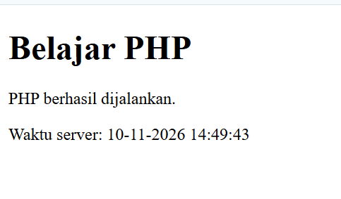

**Latihan 2** – nilai akhir 84,90, predikat B  
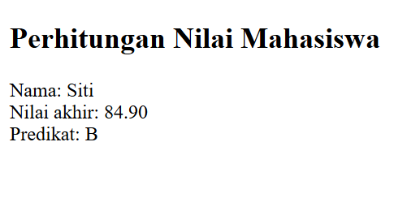

**Latihan 3** – daftar mahasiswa dengan `foreach`  
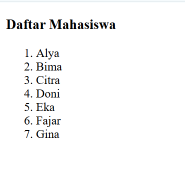

**Latihan 4** – function diskon dan luas  
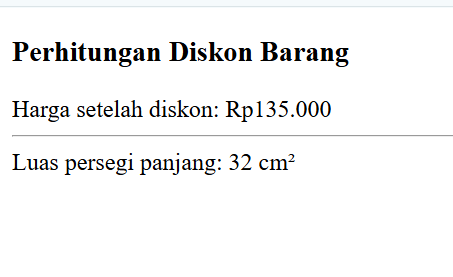

**Latihan 5** – form GET: tampilan awal dan hasil (kata kunci terlihat di URL `?kata=PHP`)  
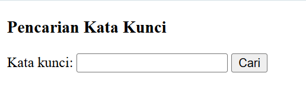
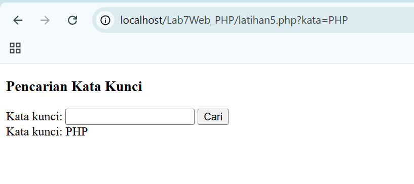

**Latihan 6** – form POST: tampilan awal, validasi `required` bawaan browser saat kolom kosong, dan data diterima  
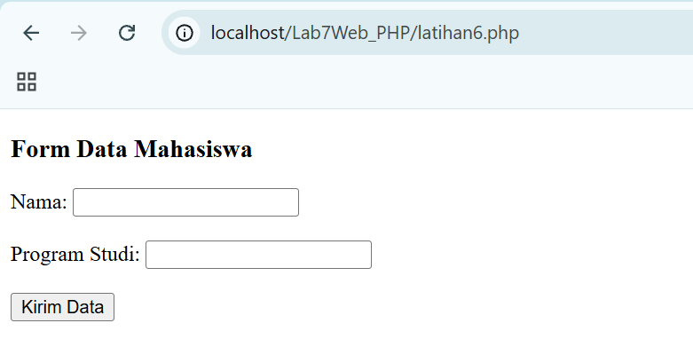
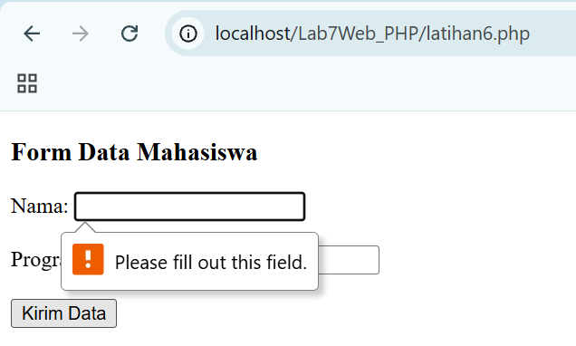
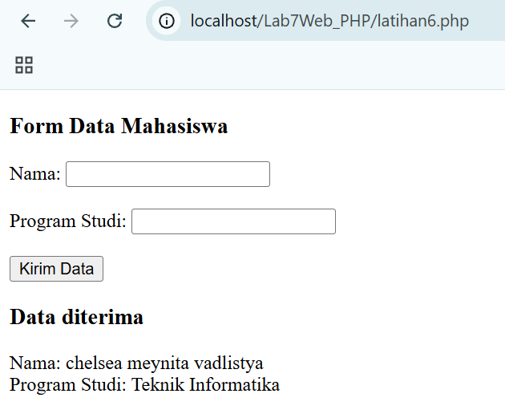

**Latihan 7** – pengolahan data barang: tampilan awal, input valid, dan input tidak valid (lihat juga bagian 7)  
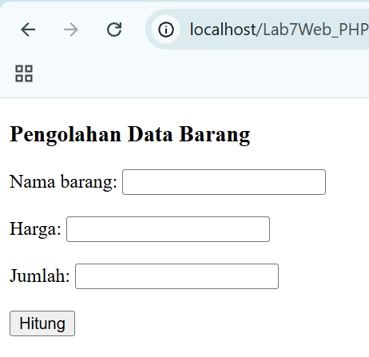
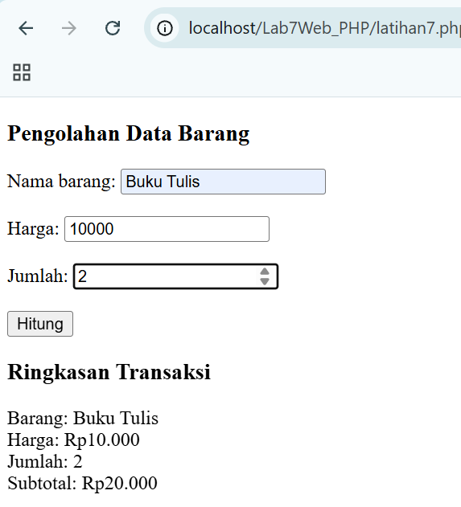
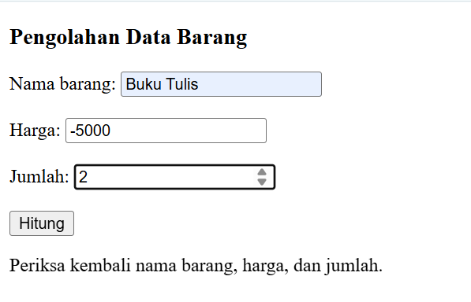

### Eksperimen

**Eksperimen 1** – rata-rata nilai 84,33  
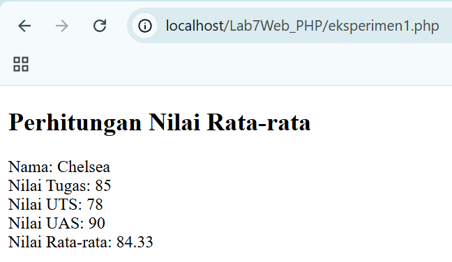

**Eksperimen 2** – pencarian nama (GET): nama yang tidak ada di array  
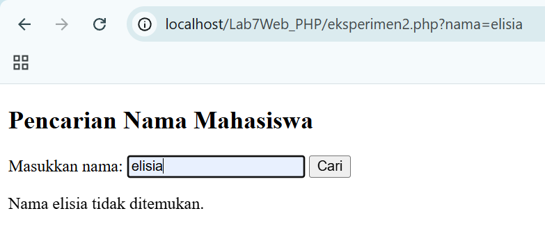
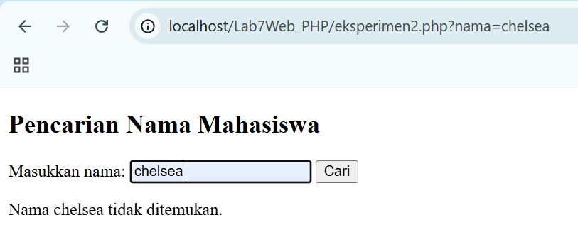

**Eksperimen 3** – function `formatRupiah()`  
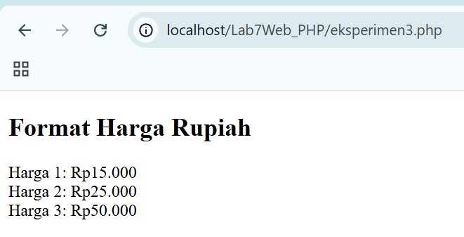

**Eksperimen 4** – validasi NIM (POST): satu input valid dan dua input tidak valid  
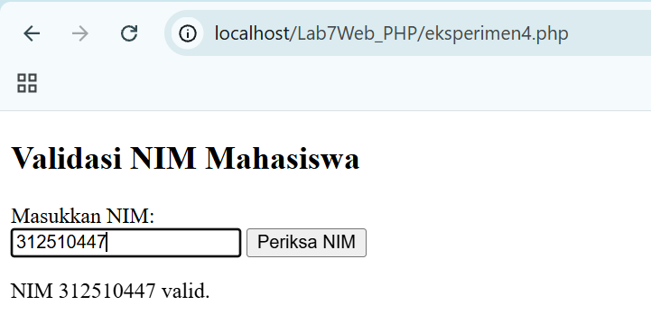
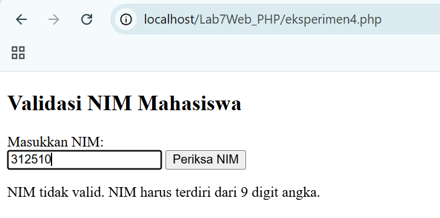
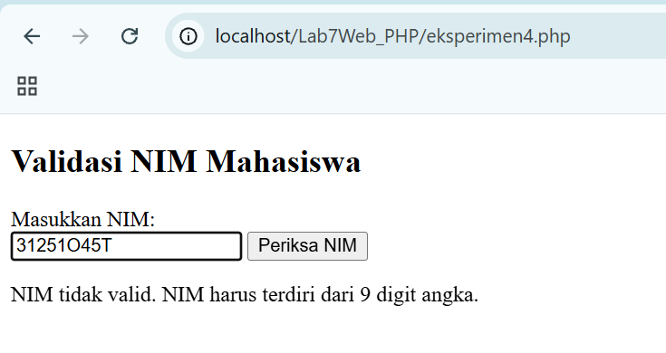

### Mini Project

**Tampilan awal dan form yang sudah diisi**  
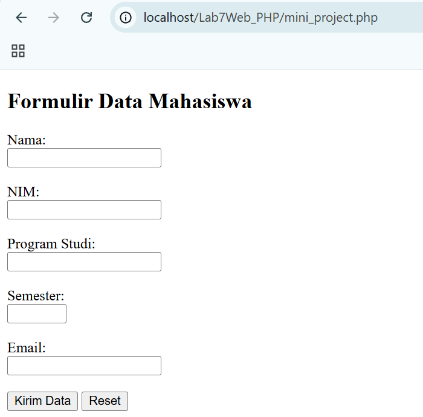
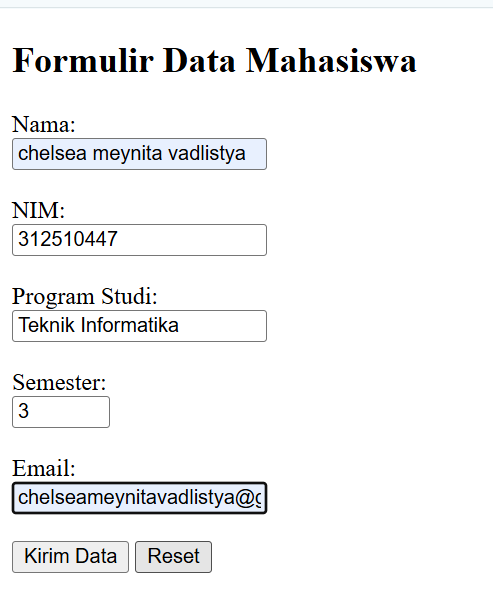

**Hasil input valid**  
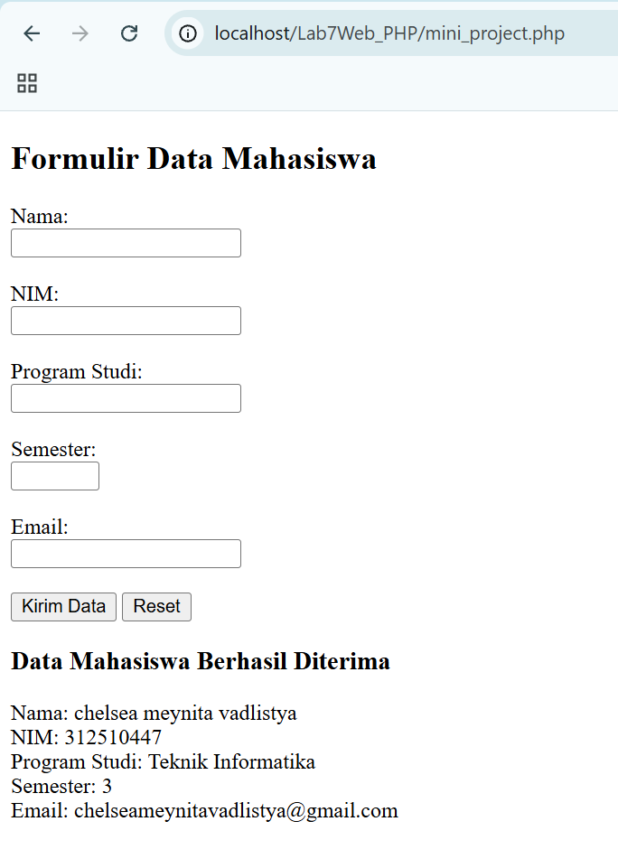
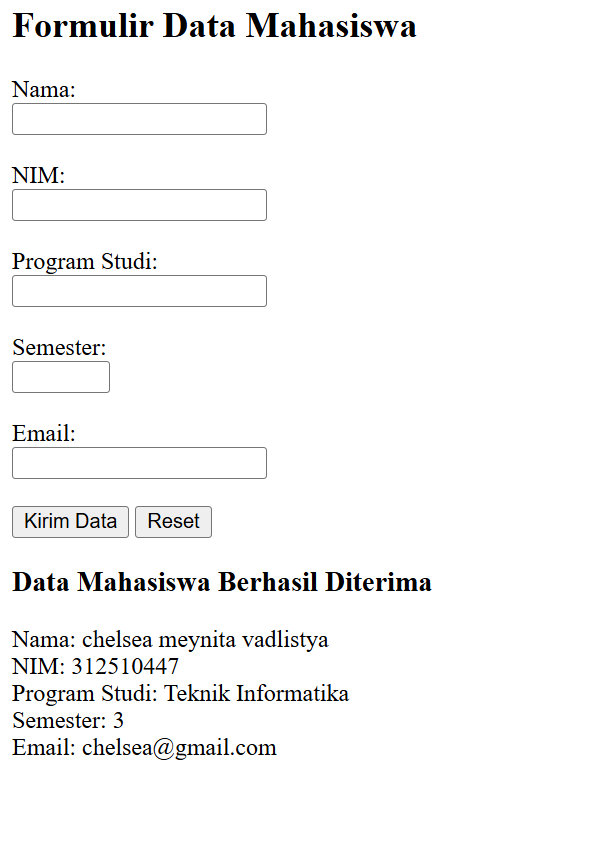

**Hasil input tidak valid (pesan kesalahan dari server)**  
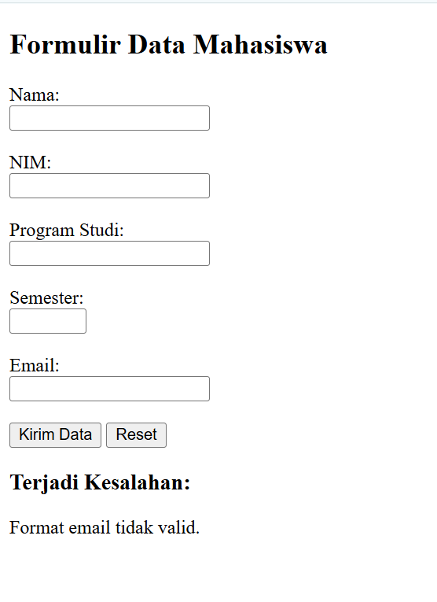
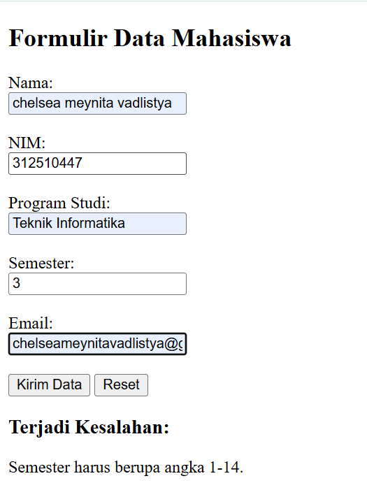

## 7. Kasus Uji Validasi Form

Validasi dilakukan di sisi server (PHP). Atribut HTML seperti `required`, `type="email"`, dan `min/max` hanya pemeriksaan awal di browser, sehingga PHP tetap memeriksa ulang.

### 7.1 Mini Project (`mini_project.php`)

Aturan: nama, NIM, dan program studi tidak boleh kosong; email harus lolos `FILTER_VALIDATE_EMAIL`; semester harus angka bulat 1–14.

| Jenis | Kasus | Hasil | Screenshot |
|---|---|---|---|
| Valid 1 | Nama Chelsea Meynita Vadlistya, NIM 312510447, Teknik Informatika, semester 3, email `chelseameynitavadlistya@gmail.com` | Semua aturan terpenuhi, muncul **"Data Mahasiswa Berhasil Diterima"** beserta kelima data. |  |
| Valid 2 | Data yang sama dengan email `chelsea@gmail.com` | Email berformat benar, data **diterima**. |  |
| Tidak valid 1 | Email dengan format salah | Pesan **"Format email tidak valid."**; data tidak ditampilkan. |  |
| Tidak valid 2 | Semester tidak memenuhi rentang 1–14 | Pesan **"Semester harus berupa angka 1-14."**; data tidak ditampilkan. |  |

### 7.2 Validasi NIM (`eksperimen4.php`)

Aturan: NIM harus tepat 9 digit angka (`/^[0-9]{9}$/`).

| Jenis | Input | Hasil | Screenshot |
|---|---|---|---|
| Valid | `312510447` | "NIM 312510447 valid." |  |
| Tidak valid 1 | `312510` (hanya 6 digit) | "NIM tidak valid. NIM harus terdiri dari 9 digit angka." |  |
| Tidak valid 2 | `31251O45T` (9 karakter, tetapi berisi huruf `O` dan `T`) | Ditolak karena bukan angka semua. |  |

### 7.3 Data Barang (`latihan7.php`)

Aturan: nama barang tidak boleh kosong, harga numerik dan tidak negatif, jumlah bilangan bulat minimal 1.

| Jenis | Input | Hasil | Screenshot |
|---|---|---|---|
| Valid 1 | Buku Tulis, harga 10000, jumlah 2 | Subtotal **Rp20.000** |  |
| Valid 2 | Buku Tulis, harga 5000, jumlah 3 | Subtotal **Rp15.000** | 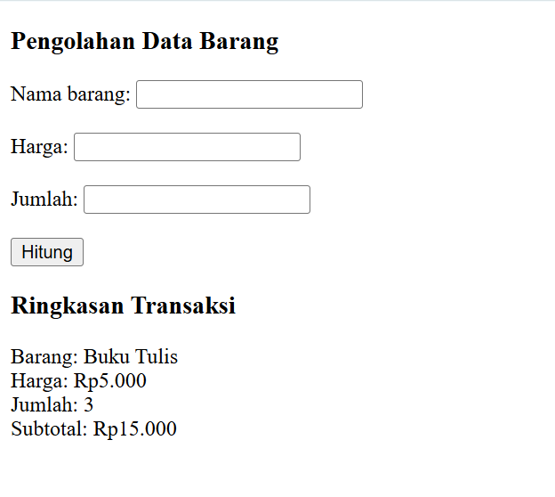 |
| Tidak valid | Buku Tulis, harga **-5000**, jumlah 2 | "Periksa kembali nama barang, harga, dan jumlah." (harga negatif ditolak) |  |

### 7.4 Catatan Pencarian (`eksperimen2.php`)

Pencarian memakai `in_array(..., true)` sehingga **peka huruf besar/kecil**. Data di array tertulis `Chelsea`, maka input `chelsea` (huruf kecil) tetap menghasilkan "tidak ditemukan", sama seperti nama yang memang tidak ada (`elisia`). Input `Chelsea` akan menghasilkan "ditemukan".

## 8. Jawaban Pertanyaan Evaluasi

**1. Apa perbedaan pemrosesan client-side dan server-side?**  
Pada _client-side_, kode (misalnya JavaScript) dijalankan di browser pengguna setelah halaman diterima. Pada _server-side_, kode (misalnya PHP) dijalankan di server; server mengolah permintaan, lalu hanya mengirim hasilnya (HTML) ke browser. Pengguna tidak dapat melihat kode PHP aslinya, hanya keluarannya.

**2. Mengapa file PHP harus dijalankan melalui web server?**  
Browser tidak bisa menafsirkan PHP. Interpreter PHP hanya aktif ketika file diminta lewat web server (`http://localhost/...`). Jika dibuka langsung (`file://`), browser hanya menampilkan kode PHP sebagai teks biasa dan tidak mengeksekusinya.

**3. Apa fungsi tanda `$` pada variabel PHP?**  
Tanda `$` adalah penanda bahwa sebuah nama merupakan variabel, misalnya `$nama = "Siti";`. Tanpa `$`, PHP menganggapnya sebagai konstanta atau nama fungsi.

**4. Apa perbedaan metode GET dan POST?**  
`GET` mengirim data lewat URL (terlihat, ada batas panjang, bisa di-_bookmark_), cocok untuk pencarian atau filter (contoh `latihan5.php`). `POST` mengirim data lewat body request (tidak tampil di URL, tanpa batas praktis), cocok untuk data yang mengubah atau menyimpan sesuatu seperti form pendaftaran (contoh `mini_project.php`). Data diambil dengan `$_GET` dan `$_POST`.

**5. Mengapa input pengguna perlu divalidasi di sisi server?**  
Validasi di browser bisa dilewati atau dimanipulasi, sehingga tidak bisa dipercaya. Server harus memeriksa ulang agar data kosong, salah format, atau berbahaya (misalnya skrip jahat dan SQL injection) tidak diproses, serta menjaga data tetap konsisten dan aplikasi aman.

**6. Apa fungsi `htmlspecialchars()` ketika menampilkan data dari form?**  
Fungsi ini mengubah karakter khusus HTML (`<`, `>`, `&`, `"`, `'`) menjadi entitas HTML (`&lt;`, `&gt;`, dll.), sehingga input seperti `<script>alert(1)</script>` tampil sebagai teks biasa dan tidak dijalankan browser. Ini mencegah serangan XSS (_Cross-Site Scripting_).

**7. Apa manfaat penggunaan function dalam program PHP?**  
- Kode bisa dipakai ulang tanpa menulis ulang (contoh `formatRupiah()` dipanggil tiga kali).  
- Program lebih rapi, mudah dibaca, dan mudah diuji.  
- Perbaikan cukup dilakukan di satu tempat.  
- Logika dapat dipisah menjadi bagian kecil sesuai tugasnya (contoh `hitungDiskon()` dan `hitungLuas()`).

## 9. Kesimpulan

Praktikum ini menunjukkan bahwa PHP berjalan di sisi server sehingga harus diakses lewat web server lokal. Pengolahan data form dengan `GET`/`POST`, validasi di server, `htmlspecialchars()` untuk keluaran yang aman, serta pemakaian function membuat program lebih benar, aman, dan terstruktur. Mini project menggabungkan seluruh konsep tersebut dalam satu formulir data mahasiswa.
